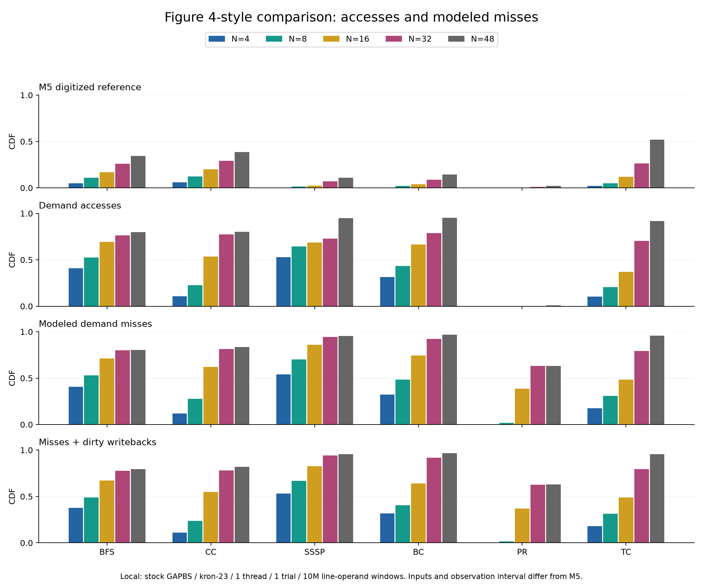
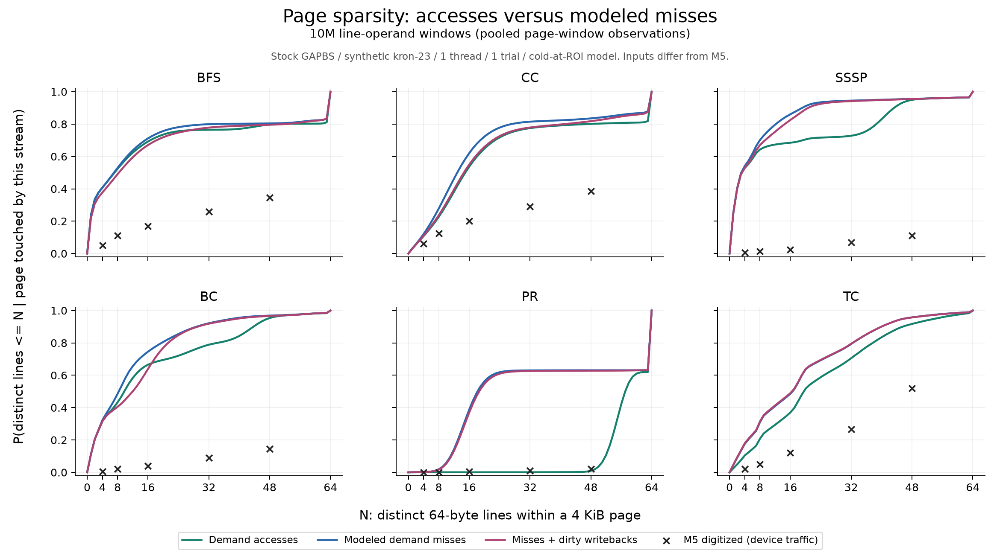
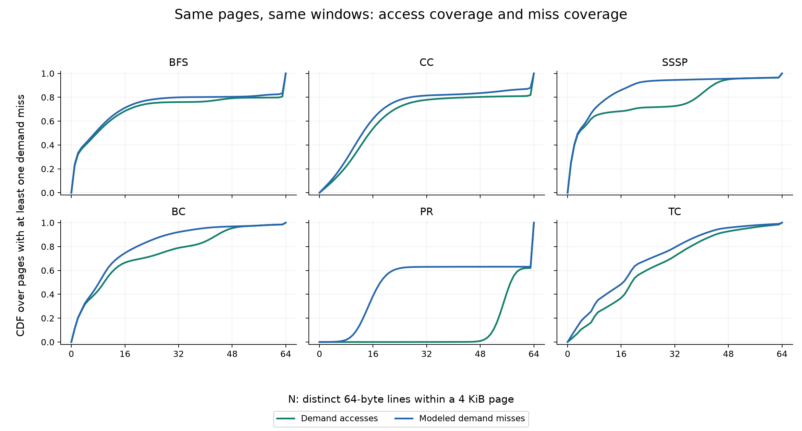
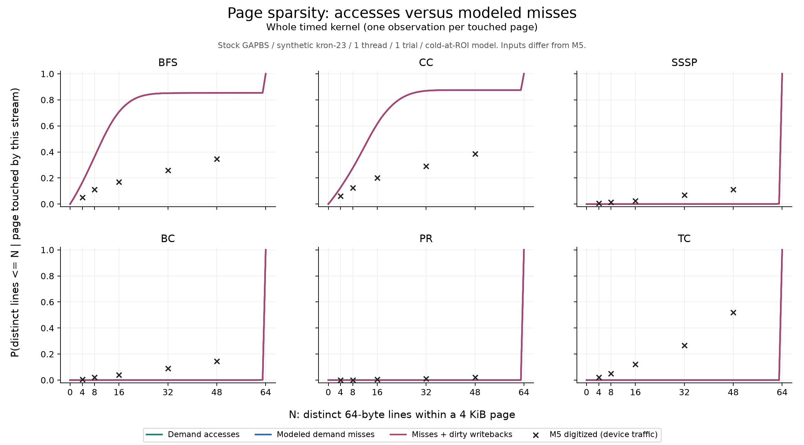

# Measurement audit (October 2026)

The code and methodology audit identified substantive mistakes. Confirmed fixes
are tested below. Historical results predate the cache-path corrections and do not
validate the corrected instrument. This is a scoped audit, not a guarantee that
every code path or simulation assumption is correct.

The target is M5 Figure 4 (page sparsity), not Figure 3 (ANB/DAMON top-K accuracy).
The access-based extension counts user-space memory operands before filtering.
M5 measures requests at the device; a software cache supplies an approximation.

## Confirmed issues and actions

- Dirty L1 writebacks can evict an L2 line without propagating that eviction.
- Store misses mark lower-level copies dirty before a dirty eviction reaches them.
- Table 3 specifies 10 LLC ways, while the artifact actually programs the 9-bit
  mask `0x7FC0`. The old 9-way choice was defensible, not an implementation bug.
  Both are now explicit controls; capacity matching is not exact CAT emulation.
- The window fitter compares P(<=48) to the prose complement P(<=47).
- Setup-inclusive userspace-load and kernel-only ROI measurements are mixed.
- Input datasets, thread counts and benchmark versions differ from Table 3.
- A window selected using the reference curve is a fitted sensitivity result,
  not independent evidence of reproduction.

- Predication was absent from the memory callback. It now follows Pin's executed
  predicate, avoiding zero-count REP observations. Software prefetch hints are
  excluded consistently from the demand-access experiment.
- The instruction/phase globals were not protected against concurrent updates.
  They and the paired measurements now use serialized state transitions. This
  does not add coherence to the private-cache models.
- Raw-dump accounting used 156 bytes for a 164-byte disk record. The cap now uses
  the actual record size. Complete-dump checks reject truncated/capped analyses.
- Simulator mean coverage was an unweighted average of epoch means. It now uses
  page-observation weights, consistent with its histogram and Pin's CDF.
- The Space-Saving HWT membership check followed insertion of the current page.
  It was ineffective; the claimed causal explanation based on HPT gating is
  withdrawn. M5 section 5.1 describes independent page and word trackers.
- Placement selected among the **next** window's pages and sized capacity using
  that future footprint. This leaked future information. Selection now operates
  only on previous-window candidates, with capacity fixed from the first window.
  Zero-score candidates cannot fill empty slots; hot-word selection respects a
  strict budget even at ties. These remain simplified heuristics, not M5 policy.
- The historical **1.505x speedup claim is withdrawn**. The corrected model has
  not regenerated that campaign; its output is an assumed serial memory cost,
  not measured runtime or a proven performance bound.
- Batch runners could hide failed subprocesses. Error propagation is enabled.
  The Redis runner no longer silently chooses a real-YCSB path lacking ROI markers.
  Server runners bind to loopback; Memcached respects the selected result root.

## New completed measurements

All six GAPBS kernels completed on synthetic **kron-23**, stock loader, one thread,
one timed invocation, cold model at first ROI, 10-way / 40 MiB LLC. The window was
predeclared as **10M line-operand references**, shared by every stream. The final
partial window is included. TC here is kron-23; the old TC headline used kron-21.
Its larger run completed in 8,374 seconds and must not be treated as a same-input
before/after comparison with the legacy result.

Each cell below is P(at most 16 distinct lines), conditional on that stream
touching the page in that window:

| Workload | Accesses | Demand misses | Misses + writebacks | M5 at N=16 (digitized) |
|---|---:|---:|---:|---:|
| BFS | 0.6924 | 0.7118 | 0.6705 | 0.170 |
| CC | 0.5363 | 0.6198 | 0.5495 | 0.200 |
| SSSP | 0.6848 | 0.8607 | 0.8253 | 0.025 |
| BC | 0.6652 | 0.7456 | 0.6388 | 0.040 |
| PR | 0.0006 | 0.3873 | 0.3688 | 0.005 |
| TC | 0.3699 | 0.4853 | 0.4894 | 0.120 |

These values **do not numerically reproduce M5**. They also cannot be compared
directly to the old 10M-device-event, setup-inclusive chart: the clock and measured
program region changed. The new purpose is a valid access-versus-miss comparison.
The figure and CSV include all five paper thresholds; the table is just a compact
example. No reference value was used to choose windows or workload parameters.






The common-population checks pass: on fill-touched pages, access coverage is at
least fill coverage in every window. For all six cold-cache runs the whole-ROI
access, fill and traffic histograms are identical. This follows from first-touch
misses and demonstrates why whole-run footprints can agree despite very different
event frequencies. It does not establish equivalence to hardware.

## Controlled checks

Same code, inputs and reference-window size; maximum absolute change across the
entire 0..64 CDF of total modeled traffic:

| Intervention | BFS | CC | SSSP | BC |
|---|---:|---:|---:|---:|
| 9 rather than 10 LLC ways | 0.002911 | 0.010549 | 0.042536 | 0.036146 |
| Warm caches during setup | 0.009174 | 0.002748 | Not run | Not run |

These controls do not close the gap in the tested workloads. SSSP reference counts
differed by nine operands between the two runs, so this is not a byte-identical
trace replay. No confidence intervals are claimed from one run per setting.

## Why closer agreement remains unresolved

1. **Inputs and parallel execution differ.** M5 specifies resized Twitter/Google
   inputs and 20 threads; our primary measurements use synthetic graphs and one
   thread. Liblinear historically used KDD2010 instead of KDD2012. Host limitations
   do not make these equivalent workloads.
2. **Scope changed in earlier comparisons.** The userspace-load experiment added
   a copy and included setup, whereas stock runs measured only the timed kernel.
   Its improved agreement cannot be credited solely to recovering kernel traffic.
3. **Figure 4's exact collection protocol is not established.** Region cycling,
   reset intervals, inclusion of zero-access allocated pages and setup inclusion
   need confirmation. Figure 3's ten execution points and daemon polling cadence
   are not enough to reconstruct Figure 4's protocol.
4. **The cache is an approximation.** Virtual indexing, LRU, no coherence and no
   hardware prefetching change the device stream. Kernel traffic and instruction
   fetches are absent from Pin. Simulator runs change several of these together,
   so they do not isolate any single cause either.

The scientifically useful next step is obtaining the exact graph subsets,
preprocessing commands and Figure 4 collection procedure from the artifact authors
or professor. Matching those is preferable to selecting a window because it fits.
The evidence does not justify saying this is the closest the PC can possibly get.

Follow-up: inspection of the official commands identified **Google+**, not the
previously tested web-Google graph. Six additional corrected BC/SSSP runs test
the original publisher's first Google+ snapshot and both window clocks. See
[the complete comparison](reproduction-followup.md); it improves agreement under
memory-event windows but does not establish M5's exact inputs or protocol.

## Verification and scope

- Focused C++ tests: dirty eviction chains, store-fill semantics, L1 hits, invalid
  geometries, common populations, mask unions, saturation, simulator weighted means
  and reset behavior.
- Analysis tests: P47 complement, address-safe merging, empty input, complete dumps,
  section parsing, incomplete paired output and causal candidate selection.
- Existing Pin synthetic stride/mixture checks passed; standalone simulator
  counter/tracker self-tests passed.
- Six main runs, four 9-way controls and two setup-warmed controls completed.
  Event totals, traffic histograms, shared populations and whole-run unions passed
  consistency checks. Commands and executable hashes are retained in manifests.
- New corrected full-system runs, Redis/Memcached/Liblinear access plots and exact
  M5 graph datasets are **not** part of this completed paired campaign. The
  full-system boundary patch now filters the device range and passes packet sizes;
  it passes an applicability check but still needs a simulator rebuild and runtime
  validation before its traffic is treated as a corrected CXL-only stream.
- The final profiler rejects active gather/scatter memory-vector instructions
  rather than silently recording incomplete addresses. This guard was added after
  the measured campaign and compiled; the final synthetic suite was rerun. The
  campaign's manifests retain the hashes of the binaries actually used.

Reproduce checks and figures:

```bash
make audit-test
python3 experiments/run_paired.py
python3 experiments/run_paired.py bfs cc sssp bc --llc-ways 9 --out results/paired-v2-9way
python3 experiments/run_paired.py bfs cc --warm-setup --out results/paired-v2-warm
./.venv/bin/python src/analysis/audit_results.py
./.venv/bin/python src/analysis/plot_paired.py
make site
```

`results/paired-v2/audit.csv` contains all numeric checks. Compact
`*.paired-summary.csv` files preserve the pooled and whole-ROI histograms needed
to regenerate the figures without retaining the much larger per-epoch files.
Existing completed runs are skipped only when the command and tool hash match;
use a new output directory for incompatible reruns.

Sources: M5 sections 3, 4.1, 5.1 and 6 / Table 3 in `papers/m5-asplos25.pdf`;
[artifact CAT script](https://github.com/ece-fast-lab/ASPLOS-2025-M5/blob/main/setup/core_pqos/set_20t_llc.sh);
[Intel Pin predicated-call documentation](https://software.intel.com/sites/landingpage/pintool/docs/98612/Pin/doc/html/group__INS__INSTRUMENTATION.html).
