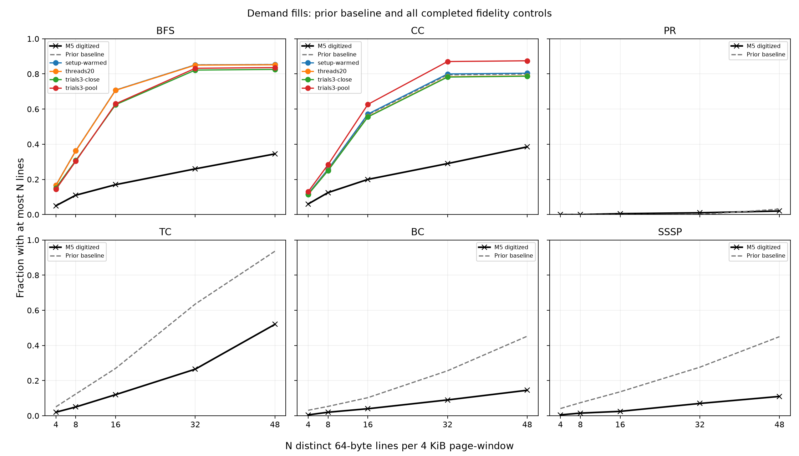

# M5 fidelity follow-up: 27 October 2026

All cases below were declared before collecting their new measurements. No window or graph reduction is selected by its agreement with the paper.

## Protocol

- Default controls: corrected Pin instrument, stock GAPBS, 40 MiB / 10-way LLC, 10M total memory-event windows, final partial windows retained.
- Thread control: BFS/CC at 20 software threads. The model has private per-thread caches and a serialized shared LLC; no coherence or true hardware scheduling.
- Trial controls: BFS/CC at three trials, with and without closing a window at each ROI boundary. Three trials are a scope sensitivity test; artifact performance commands use 200.
- Additional scope control: BFS/CC with 200 trials, one thread, no forced window reset between ROI calls. Added after the three-trial pilot, using the published trial count rather than optimizing a reference score. This isolates repetition; it does not claim the complete 20-thread artifact execution.
- Cache-state control: BFS/CC with caches warmed during setup. Warm-up references do not enter the observation population.
- PageRank control: one trial with artifact convergence settings (-i1000 -t1e-4). The artifact performance command uses 20 trials.
- Twitter: induced vertex subsets selected by SplitMix64(original ID)%4 < 3 for BFS/CC/PR, < 1 for TC. Relabel retained vertices in ascending original-ID order, then use GAPBS symmetrization/deduplication. These are our documented reductions; the authors reductions remain unavailable.
- Google+: published snapshot 4 for BC and snapshot 2 for SSSP; direction preserved. SSSP weights generated by GAPBS, since authors weights are unavailable.
- Dataset follow-ups use one thread/trial and unchanged 10M memory-event windows. Inputs and execution changes are assessed separately.
- Accesses, demand fills and total traffic remain separate metrics. All five thresholds are scored; no best-case selection.

## Progress

| Job | State |
|---|---|
| threads20-bfs | complete |
| threads20-cc | complete |
| trials3-close-bfs | complete |
| trials3-close-cc | complete |
| trials3-pool-bfs | complete |
| trials3-pool-cc | complete |
| setup-warmed-bfs | complete |
| setup-warmed-cc | complete |
| pr-artifact-convergence-pr | running |
| prepare-inputs | queued |
| dataset-bfs | queued |
| dataset-cc | queued |
| dataset-pr | queued |
| dataset-tc | queued |
| dataset-bc | queued |
| dataset-sssp | queued |
| trials200-pool-bfs | queued after input campaign |
| trials200-pool-cc | queued after input campaign |

## Completed comparisons

| Case | Workload | Scope | Access error | Fill error | Traffic error | Baseline pooled fill error |
|---|---|---|---:|---:|---:|---:|
| setup-warmed | bfs | pooled | 0.591 | 0.591 | 0.591 | 0.591 |
| setup-warmed | bfs | whole | 0.591 | 0.591 | 0.591 | 0.591 |
| setup-warmed | cc | pooled | 0.510 | 0.510 | 0.510 | 0.505 |
| setup-warmed | cc | whole | 0.579 | 0.579 | 0.579 | 0.505 |
| threads20 | bfs | pooled | 0.590 | 0.590 | 0.590 | 0.591 |
| threads20 | bfs | whole | 0.590 | 0.590 | 0.590 | 0.591 |
| threads20 | cc | pooled | 0.494 | 0.494 | 0.494 | 0.505 |
| threads20 | cc | whole | 0.579 | 0.579 | 0.579 | 0.505 |
| trials3-close | bfs | pooled | 0.562 | 0.562 | 0.562 | 0.591 |
| trials3-close | bfs | whole | 0.584 | 0.584 | 0.584 | 0.591 |
| trials3-close | cc | pooled | 0.492 | 0.492 | 0.492 | 0.505 |
| trials3-close | cc | whole | 0.579 | 0.579 | 0.579 | 0.505 |
| trials3-pool | bfs | pooled | 0.572 | 0.572 | 0.572 | 0.591 |
| trials3-pool | bfs | whole | 0.584 | 0.584 | 0.584 | 0.591 |
| trials3-pool | cc | pooled | 0.580 | 0.580 | 0.580 | 0.505 |
| trials3-pool | cc | whole | 0.579 | 0.579 | 0.579 | 0.505 |

Errors are maximum absolute differences from the digitized reference over N=4,8,16,32,48; 0.10 means ten percentage points. They are similarity scores, not evidence of identical methodology.

## Remaining evidence gaps

The official artifact still omits its dataset-download link and a recovered Figure 4 collection runner. The exact reduced graphs, region/reset schedule, page denominator and Figure 4 trial configuration remain unresolved. The draft author request has not been sent. Additional storage removes the capacity restriction, not this evidence gap.

The full-system checkpoint validation uses a bounded guest dd workload and compares final probe files and completion tick after process death/restore. Passing synthetic tests alone does not certify full-system recovery or reboot survival. The existing PageRank attempt has no recoverable checkpoint.
