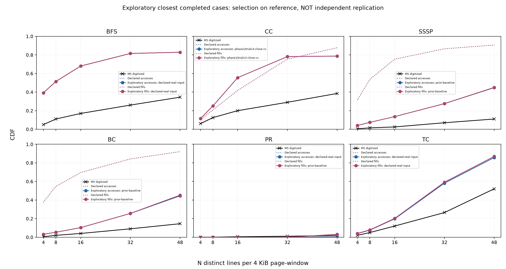
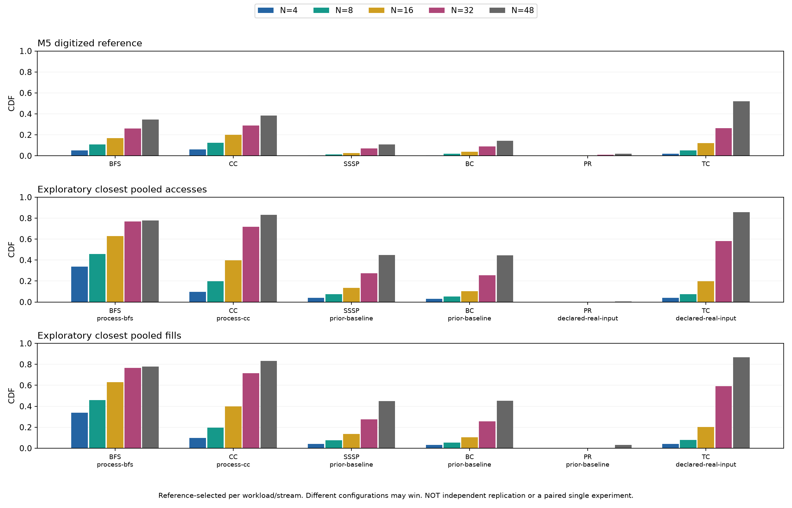

# Pin fidelity stage 2: 28 October 2026

All controls are preserved. The declared real-input baseline remains the primary comparison. Closest-case selection below uses the reference itself and is exploratory, not independent validation or a recovered M5 protocol.

Candidate scores include the prior uniform-window baseline and completed phase 1 execution controls; improvements from earlier inputs are not discarded when a newer input performs worse. All candidates keep the 10M-event clock.

## Declared protocol

Full observed process versus timed-kernel collection; real-input 20-thread controls; separate nine-way LLC controls. All use paired accesses/fills/traffic and 10M memory-event boundaries, with partial final windows and separate whole-ROI distributions. Footprint candidates use hash fractions 11/16, 10/16, 12/16, in that order, targeting native 20-thread TC RSS of 5,000,000,000 bytes. Stop at the first candidate within 10%; otherwise select the nearest RSS and label the mismatch. No Pin CDF enters this input selection.

## Progress

Campaign: waiting for declared repetition controls

| Job | State |
|---|---|

## All completed scores

| Case | Workload | Scope | Stream | Max difference (pp) | Threads | LLC ways | Collection |
|---|---|---|---|---:|---:|---:|---|
| prior-baseline | bfs | pooled | accesses | 59.14 | 1 | 10 | timed kernel |
| prior-baseline | bfs | pooled | fills | 59.14 | 1 | 10 | timed kernel |
| prior-baseline | bfs | pooled | traffic | 59.14 | 1 | 10 | timed kernel |
| prior-baseline | bfs | whole | accesses | 59.14 | 1 | 10 | timed kernel |
| prior-baseline | bfs | whole | fills | 59.14 | 1 | 10 | timed kernel |
| prior-baseline | bfs | whole | traffic | 59.14 | 1 | 10 | timed kernel |
| prior-baseline | cc | pooled | accesses | 50.47 | 1 | 10 | timed kernel |
| prior-baseline | cc | pooled | fills | 50.47 | 1 | 10 | timed kernel |
| prior-baseline | cc | pooled | traffic | 50.47 | 1 | 10 | timed kernel |
| prior-baseline | cc | whole | accesses | 57.94 | 1 | 10 | timed kernel |
| prior-baseline | cc | whole | fills | 57.94 | 1 | 10 | timed kernel |
| prior-baseline | cc | whole | traffic | 57.94 | 1 | 10 | timed kernel |
| prior-baseline | sssp | pooled | accesses | 33.72 | 1 | 10 | timed kernel |
| prior-baseline | sssp | pooled | fills | 34.00 | 1 | 10 | timed kernel |
| prior-baseline | sssp | pooled | traffic | 33.87 | 1 | 10 | timed kernel |
| prior-baseline | sssp | whole | accesses | 10.71 | 1 | 10 | timed kernel |
| prior-baseline | sssp | whole | fills | 10.71 | 1 | 10 | timed kernel |
| prior-baseline | sssp | whole | traffic | 10.71 | 1 | 10 | timed kernel |
| prior-baseline | bc | pooled | accesses | 29.97 | 1 | 10 | timed kernel |
| prior-baseline | bc | pooled | fills | 30.75 | 1 | 10 | timed kernel |
| prior-baseline | bc | pooled | traffic | 30.34 | 1 | 10 | timed kernel |
| prior-baseline | bc | whole | accesses | 14.45 | 1 | 10 | timed kernel |
| prior-baseline | bc | whole | fills | 14.45 | 1 | 10 | timed kernel |
| prior-baseline | bc | whole | traffic | 14.45 | 1 | 10 | timed kernel |
| prior-baseline | pr | pooled | accesses | 1.99 | 1 | 10 | timed kernel |
| prior-baseline | pr | pooled | fills | 1.08 | 1 | 10 | timed kernel |
| prior-baseline | pr | pooled | traffic | 1.13 | 1 | 10 | timed kernel |
| prior-baseline | pr | whole | accesses | 1.99 | 1 | 10 | timed kernel |
| prior-baseline | pr | whole | fills | 1.99 | 1 | 10 | timed kernel |
| prior-baseline | pr | whole | traffic | 1.99 | 1 | 10 | timed kernel |
| prior-baseline | tc | pooled | accesses | 41.55 | 1 | 10 | timed kernel |
| prior-baseline | tc | pooled | fills | 41.61 | 1 | 10 | timed kernel |
| prior-baseline | tc | pooled | traffic | 41.57 | 1 | 10 | timed kernel |
| prior-baseline | tc | whole | accesses | 51.99 | 1 | 10 | timed kernel |
| prior-baseline | tc | whole | fills | 51.99 | 1 | 10 | timed kernel |
| prior-baseline | tc | whole | traffic | 51.99 | 1 | 10 | timed kernel |
| declared-real-input | bfs | pooled | accesses | 55.54 | 1 | 10 | timed kernel |
| declared-real-input | bfs | pooled | fills | 55.56 | 1 | 10 | timed kernel |
| declared-real-input | bfs | pooled | traffic | 55.47 | 1 | 10 | timed kernel |
| declared-real-input | bfs | whole | accesses | 58.38 | 1 | 10 | timed kernel |
| declared-real-input | bfs | whole | fills | 58.38 | 1 | 10 | timed kernel |
| declared-real-input | bfs | whole | traffic | 58.38 | 1 | 10 | timed kernel |
| declared-real-input | cc | pooled | accesses | 49.20 | 1 | 10 | timed kernel |
| declared-real-input | cc | pooled | fills | 49.22 | 1 | 10 | timed kernel |
| declared-real-input | cc | pooled | traffic | 48.92 | 1 | 10 | timed kernel |
| declared-real-input | cc | whole | accesses | 52.60 | 1 | 10 | timed kernel |
| declared-real-input | cc | whole | fills | 52.60 | 1 | 10 | timed kernel |
| declared-real-input | cc | whole | traffic | 52.60 | 1 | 10 | timed kernel |
| declared-real-input | sssp | pooled | accesses | 79.59 | 1 | 10 | timed kernel |
| declared-real-input | sssp | pooled | fills | 79.65 | 1 | 10 | timed kernel |
| declared-real-input | sssp | pooled | traffic | 79.59 | 1 | 10 | timed kernel |
| declared-real-input | sssp | whole | accesses | 10.94 | 1 | 10 | timed kernel |
| declared-real-input | sssp | whole | fills | 10.94 | 1 | 10 | timed kernel |
| declared-real-input | sssp | whole | traffic | 10.94 | 1 | 10 | timed kernel |
| declared-real-input | bc | pooled | accesses | 77.53 | 1 | 10 | timed kernel |
| declared-real-input | bc | pooled | fills | 77.58 | 1 | 10 | timed kernel |
| declared-real-input | bc | pooled | traffic | 77.24 | 1 | 10 | timed kernel |
| declared-real-input | bc | whole | accesses | 14.08 | 1 | 10 | timed kernel |
| declared-real-input | bc | whole | fills | 14.08 | 1 | 10 | timed kernel |
| declared-real-input | bc | whole | traffic | 14.08 | 1 | 10 | timed kernel |
| declared-real-input | pr | pooled | accesses | 1.54 | 1 | 10 | timed kernel |
| declared-real-input | pr | pooled | fills | 1.53 | 1 | 10 | timed kernel |
| declared-real-input | pr | pooled | traffic | 1.47 | 1 | 10 | timed kernel |
| declared-real-input | pr | whole | accesses | 2.00 | 1 | 10 | timed kernel |
| declared-real-input | pr | whole | fills | 2.00 | 1 | 10 | timed kernel |
| declared-real-input | pr | whole | traffic | 2.00 | 1 | 10 | timed kernel |
| declared-real-input | tc | pooled | accesses | 33.67 | 1 | 10 | timed kernel |
| declared-real-input | tc | pooled | fills | 34.87 | 1 | 10 | timed kernel |
| declared-real-input | tc | pooled | traffic | 34.87 | 1 | 10 | timed kernel |
| declared-real-input | tc | whole | accesses | 22.88 | 1 | 10 | timed kernel |
| declared-real-input | tc | whole | fills | 22.88 | 1 | 10 | timed kernel |
| declared-real-input | tc | whole | traffic | 22.88 | 1 | 10 | timed kernel |
| phase1/threads20-bfs | bfs | pooled | accesses | 59.00 | 20 | 10 | timed kernel |
| phase1/threads20-bfs | bfs | pooled | fills | 59.00 | 20 | 10 | timed kernel |
| phase1/threads20-bfs | bfs | pooled | traffic | 59.00 | 20 | 10 | timed kernel |
| phase1/threads20-bfs | bfs | whole | accesses | 59.00 | 20 | 10 | timed kernel |
| phase1/threads20-bfs | bfs | whole | fills | 59.00 | 20 | 10 | timed kernel |
| phase1/threads20-bfs | bfs | whole | traffic | 59.00 | 20 | 10 | timed kernel |
| phase1/threads20-cc | cc | pooled | accesses | 49.40 | 20 | 10 | timed kernel |
| phase1/threads20-cc | cc | pooled | fills | 49.40 | 20 | 10 | timed kernel |
| phase1/threads20-cc | cc | pooled | traffic | 49.40 | 20 | 10 | timed kernel |
| phase1/threads20-cc | cc | whole | accesses | 57.95 | 20 | 10 | timed kernel |
| phase1/threads20-cc | cc | whole | fills | 57.95 | 20 | 10 | timed kernel |
| phase1/threads20-cc | cc | whole | traffic | 57.95 | 20 | 10 | timed kernel |
| phase1/trials3-close-bfs | bfs | pooled | accesses | 56.20 | 1 | 10 | timed kernel |
| phase1/trials3-close-bfs | bfs | pooled | fills | 56.19 | 1 | 10 | timed kernel |
| phase1/trials3-close-bfs | bfs | pooled | traffic | 56.18 | 1 | 10 | timed kernel |
| phase1/trials3-close-bfs | bfs | whole | accesses | 58.39 | 1 | 10 | timed kernel |
| phase1/trials3-close-bfs | bfs | whole | fills | 58.39 | 1 | 10 | timed kernel |
| phase1/trials3-close-bfs | bfs | whole | traffic | 58.39 | 1 | 10 | timed kernel |
| phase1/trials3-close-cc | cc | pooled | accesses | 49.20 | 1 | 10 | timed kernel |
| phase1/trials3-close-cc | cc | pooled | fills | 49.21 | 1 | 10 | timed kernel |
| phase1/trials3-close-cc | cc | pooled | traffic | 49.21 | 1 | 10 | timed kernel |
| phase1/trials3-close-cc | cc | whole | accesses | 57.94 | 1 | 10 | timed kernel |
| phase1/trials3-close-cc | cc | whole | fills | 57.94 | 1 | 10 | timed kernel |
| phase1/trials3-close-cc | cc | whole | traffic | 57.94 | 1 | 10 | timed kernel |
| phase1/trials3-pool-bfs | bfs | pooled | accesses | 57.21 | 1 | 10 | timed kernel |
| phase1/trials3-pool-bfs | bfs | pooled | fills | 57.21 | 1 | 10 | timed kernel |
| phase1/trials3-pool-bfs | bfs | pooled | traffic | 57.20 | 1 | 10 | timed kernel |
| phase1/trials3-pool-bfs | bfs | whole | accesses | 58.39 | 1 | 10 | timed kernel |
| phase1/trials3-pool-bfs | bfs | whole | fills | 58.39 | 1 | 10 | timed kernel |
| phase1/trials3-pool-bfs | bfs | whole | traffic | 58.39 | 1 | 10 | timed kernel |
| phase1/trials3-pool-cc | cc | pooled | accesses | 58.04 | 1 | 10 | timed kernel |
| phase1/trials3-pool-cc | cc | pooled | fills | 58.04 | 1 | 10 | timed kernel |
| phase1/trials3-pool-cc | cc | pooled | traffic | 58.04 | 1 | 10 | timed kernel |
| phase1/trials3-pool-cc | cc | whole | accesses | 57.94 | 1 | 10 | timed kernel |
| phase1/trials3-pool-cc | cc | whole | fills | 57.94 | 1 | 10 | timed kernel |
| phase1/trials3-pool-cc | cc | whole | traffic | 57.94 | 1 | 10 | timed kernel |
| phase1/setup-warmed-bfs | bfs | pooled | accesses | 59.14 | 1 | 10 | timed kernel |
| phase1/setup-warmed-bfs | bfs | pooled | fills | 59.14 | 1 | 10 | timed kernel |
| phase1/setup-warmed-bfs | bfs | pooled | traffic | 59.14 | 1 | 10 | timed kernel |
| phase1/setup-warmed-bfs | bfs | whole | accesses | 59.14 | 1 | 10 | timed kernel |
| phase1/setup-warmed-bfs | bfs | whole | fills | 59.14 | 1 | 10 | timed kernel |
| phase1/setup-warmed-bfs | bfs | whole | traffic | 59.14 | 1 | 10 | timed kernel |
| phase1/setup-warmed-cc | cc | pooled | accesses | 50.98 | 1 | 10 | timed kernel |
| phase1/setup-warmed-cc | cc | pooled | fills | 50.98 | 1 | 10 | timed kernel |
| phase1/setup-warmed-cc | cc | pooled | traffic | 50.98 | 1 | 10 | timed kernel |
| phase1/setup-warmed-cc | cc | whole | accesses | 57.94 | 1 | 10 | timed kernel |
| phase1/setup-warmed-cc | cc | whole | fills | 57.94 | 1 | 10 | timed kernel |
| phase1/setup-warmed-cc | cc | whole | traffic | 57.95 | 1 | 10 | timed kernel |
| phase1/pr-artifact-convergence-pr | pr | pooled | accesses | 1.99 | 1 | 10 | timed kernel |
| phase1/pr-artifact-convergence-pr | pr | pooled | fills | 1.08 | 1 | 10 | timed kernel |
| phase1/pr-artifact-convergence-pr | pr | pooled | traffic | 1.13 | 1 | 10 | timed kernel |
| phase1/pr-artifact-convergence-pr | pr | whole | accesses | 1.99 | 1 | 10 | timed kernel |
| phase1/pr-artifact-convergence-pr | pr | whole | fills | 1.99 | 1 | 10 | timed kernel |
| phase1/pr-artifact-convergence-pr | pr | whole | traffic | 1.99 | 1 | 10 | timed kernel |
| phase1/trials200-pool-bfs | bfs | pooled | accesses | 59.57 | 1 | 10 | timed kernel |
| phase1/trials200-pool-bfs | bfs | pooled | fills | 59.57 | 1 | 10 | timed kernel |
| phase1/trials200-pool-bfs | bfs | pooled | traffic | 59.56 | 1 | 10 | timed kernel |
| phase1/trials200-pool-bfs | bfs | whole | accesses | 24.14 | 1 | 10 | timed kernel |
| phase1/trials200-pool-bfs | bfs | whole | fills | 24.14 | 1 | 10 | timed kernel |
| phase1/trials200-pool-bfs | bfs | whole | traffic | 24.14 | 1 | 10 | timed kernel |

## Exploratory closest pooled cases

Access and fill winners may use different configurations and are not a paired single experiment. No pooled result is replaced by a more flattering whole-ROI result. Neither a lower score nor a passed unit test establishes hardware equivalence.
