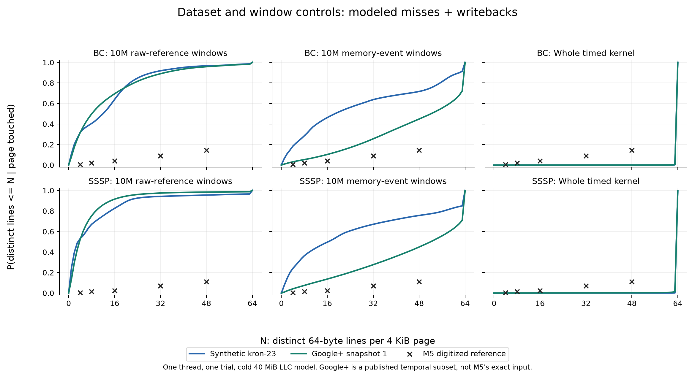

# Dataset and observation-window follow-up

This is a controlled attempt to reduce the mismatch, not a fitted reproduction.
The original corrected access/miss results remain unchanged in `paired-v2`.

## Plan declared before the new measurements

- Compare BC and SSSP on kron-23 and the first published Google+ snapshot.
- Use both 10M raw line-operand windows and 10M modeled memory-event windows.
- Hold the cache, cold-at-ROI scope, one thread and one trial constant.
- Report every setting, full-ROI coverage and all five Figure 4 thresholds.
- Do not select a window or graph based on its error against M5.
- No multi-thread fidelity claims: the Pin cache still lacks coherence.

The first Google+ snapshot is a published temporal dataset boundary, selected
for a manageable conversion/profile on this machine, not to fit M5's curve.
It is not M5's exact reduced input. Both topology and size change relative to
kron-23, so the graph comparison does not isolate either alone.

## Artifact findings

Checked official M5 revision `d3d90d9308a4abd3af70e99c81d4ed8d445320cf`.

- BC: `gplus/gplus/imc12/direct_social_structure.wel -n100`.
- SSSP: `gplus/gplus/imc12/direct_social_structure_3-5G.wel -n200`.
- BFS: `twitter_reduced_6G.sg -n200`.
- PR: `twitter_reduced_6G.sg -i1000 -t1e-4 -n20`.
- The dataset section says inputs were reduced below 8 GB, but its download
  location is blank. Figure 4 is not among the README's reproduced experiments.

**Correction:** our previous `web-Google` test was a Google web-link graph, not
the Google+ social graph named in the artifact. It cannot rule out an effect
from using the intended dataset family. The public Google+ publisher describes
the third column as first-seen TimeID, not an SSSP distance. The artifact's
conversion/weight generation for its `.wel` files remains unconfirmed.

The native kron-23 PR check with `-i1000 -t1e-4 -n1 -l` stopped after nine
iterations (indices 0..8). Thus the previous cap of 20 was not binding on this
input; merely changing the cap is not an explanation for its mismatch.

M5 reference [1] points to GraphBrew, so upstream GAPBS must not be described as
proven byte-identical to the authors' implementation. We retained the local
GAPBS build to hold code constant in this input/window experiment.

## Local input preparation

The public archive SHA-256 is
`24a3a97523f18dfedf912400d5022fbef6ce89627a5e53a4fc37368e65e358d5`.
The importer streams its nested edge archive, validates every record and keeps
all edges with TimeID zero. The extracted count matches the publisher:
4,693,129 vertices and 47,130,325 directed edges. IDs are not renumbered.

GAPBS converter revision `2972aeb2703165bafd921222f4ed7196f542d3a8`
(binary SHA-256 `51f98629a2ba8155102b46b56cdfdb074d677295272fb5a80c4d13a3256a83a7`)
produced both serialized inputs without changing the edge count. SSSP weights
are GAPBS-generated integers in [1,255], using its fixed seed 27491095.
This is a documented local choice, not a claim about M5's weights. Both BC and
SSSP passed their native `-v` verification on the converted graphs.

```bash
python3 benchmarks/prepare_gplus.py workloads/gapbs/graphs/gplus.zip workloads/gapbs/graphs/gplus-snapshot1.el
env OMP_NUM_THREADS=1 workloads/gapbs/converter -f workloads/gapbs/graphs/gplus-snapshot1.el -b workloads/gapbs/graphs/gplus-snapshot1.sg
env OMP_NUM_THREADS=1 workloads/gapbs/converter -f workloads/gapbs/graphs/gplus-snapshot1.el -wb workloads/gapbs/graphs/gplus-snapshot1.wsg
./.venv/bin/python experiments/run_paired.py bc sssp --epoch-traffic 10 --out results/matched-family/kron-traffic10
./.venv/bin/python experiments/run_paired.py bc sssp --graph-prefix workloads/gapbs/graphs/gplus-snapshot1 --graph-family 'Google+ IMC12 snapshot 1' --out results/matched-family/gplus-refs10
./.venv/bin/python experiments/run_paired.py bc sssp --graph-prefix workloads/gapbs/graphs/gplus-snapshot1 --graph-family 'Google+ IMC12 snapshot 1' --epoch-traffic 10 --out results/matched-family/gplus-traffic10
./.venv/bin/python src/analysis/compare_reproduction.py
```

The archive comes from the publisher's download link above. Raw data remains
ignored by Git; compact summaries and source/run hashes are retained. The old
10M-reference runs provide the synthetic-reference baseline. The profiler has
the same cache semantics, with a later guard against unsupported vector-memory
instructions; neither kernel uses that unsupported path. These are single runs,
not error bars or proof of repeatability. Host wall-clock times are not speedups.

Sources:
- [M5 BC command](https://github.com/ece-fast-lab/ASPLOS-2025-M5/blob/d3d90d9308a4abd3af70e99c81d4ed8d445320cf/testing_scripts/20_threads/bench_cmds/gapbs-bc.sh)
- [M5 SSSP command](https://github.com/ece-fast-lab/ASPLOS-2025-M5/blob/d3d90d9308a4abd3af70e99c81d4ed8d445320cf/testing_scripts/20_threads/bench_cmds/gapbs-sssp.sh)
- [M5 PR command](https://github.com/ece-fast-lab/ASPLOS-2025-M5/blob/d3d90d9308a4abd3af70e99c81d4ed8d445320cf/testing_scripts/20_threads/bench_cmds/gapbs-pr.sh)
- [M5 experiment instructions](https://github.com/ece-fast-lab/ASPLOS-2025-M5/blob/d3d90d9308a4abd3af70e99c81d4ed8d445320cf/testing_scripts/README.md)
- [Google+ original publisher and download](https://people.duke.edu/~zg70/gplus.html)

## Results

All six new runs completed successfully. The two existing synthetic reference
runs make eight comparison cells. Dataset parsing tests, GAPBS native correctness
checks, cache/analysis regressions and all eight measurement consistency checks
passed. No benchmark from this campaign is left running.

Maximum absolute CDF difference at **all five** digitized M5 thresholds
(4, 8, 16, 32, 48 lines), using modeled demand misses plus dirty writebacks:

| Input | Window | BC error | SSSP error |
|---|---|---:|---:|
| Synthetic kron-23 | 10M raw references | 0.8286 | 0.8719 |
| Synthetic kron-23 | 10M memory events | 0.5720 | 0.6461 |
| Google+ snapshot 1 | 10M raw references | 0.8133 | 0.9044 |
| Google+ snapshot 1 | 10M memory events | 0.3034 | 0.3387 |

At the **same 10M memory-event window**, using Google+ reduces this error by
47.0% for BC and 47.6% for SSSP. Mean absolute error over the five points also
falls: BC 0.3972 -> 0.1183, SSSP 0.4602 -> 0.1506. This is closer numerical
agreement under a declared control, **not a successful numerical reproduction**.
At 10M raw references, SSSP gets worse, and BC's mean error also gets worse.
There is no unconditional "real graphs fix the problem" finding.

At N=16, Google+ with memory-event windows gives BC 0.1030 versus M5's 0.040,
and SSSP 0.1367 versus 0.025. Those points alone must not be used to hide the
larger discrepancies at the other thresholds.



Whole-kernel coverage remains almost fully dense and mostly undershoots M5's
CDF. It is included as a diagnostic, not selected as the winning reproduction.
All three streams have identical whole-kernel coverage in these cold-start runs,
but their frequencies differ. No figure is a measured CXL-device trace.

### Interpretation and limits

- We corrected a concrete dataset-family mistake: Google web links and Google+
  social links are not interchangeable. The new graph is from the archive
  named by the artifact's directory structure.
- Google+ has a smaller footprint than kron-23. A fixed number of memory events
  covers more of its execution/footprint, so improved agreement cannot be
  assigned solely to topology. Direction, size and topology all change.
- Google+ BC produced 39,252,744 memory events in each run, yielding four
  memory-event windows. Google+ SSSP produced about 18.3M, yielding only two.
  Final partial windows are included in every setting. No confidence interval
  follows from this small single-run comparison.
- These are separate executions, not identical trace replays. Google+ SSSP's
  total memory events differ by 6,014 (about 0.033%) between window runs; its
  whole-kernel touched-page counts differ by 60. Disabling ASLR did not make the
  observed measurements bit-identical. The exact cause of that residual
  difference is not isolated here.
- M5's exact reduction, SSSP edge weights, benchmark revision, 20-thread setup,
  artifact trial counts (100/200 versus one), and Figure 4 collection protocol
  remain unmatched. Local substitutes remain labeled as such; no window was fitted.
- No full-system simulator rerun is included. The earlier corrected paired
  results for the other four GAPBS kernels remain unchanged.

The next useful request to the authors is specific: provide
`direct_social_structure.wel`, `direct_social_structure_3-5G.wel`,
`twitter_reduced_6G.sg`, their generating commands, and the Figure 4 counter
collection/reset procedure. The original archive is accessible on this PC;
the missing reduced inputs and procedure are now the concrete reproducibility
gaps, not an established hardware ceiling.

Machine-readable findings: `results/matched-family/scores.csv` and
`comparison.csv`. Compact histograms, run commands, input/executable/tool hashes
and dataset-source metadata are retained alongside them. The plotting command
refuses incomplete runs and checks event totals, stream populations and unions.

## Subsequent full campaign

The [uniform-window report](uniform-windows.md) extends this BC/SSSP experiment
to all six GAPBS kernels. It preserves the controls above: PageRank gets close,
BFS/CC get worse and the remaining curves still disagree. The six-column primary
figure no longer mixes raw-reference and memory-event clocks.

