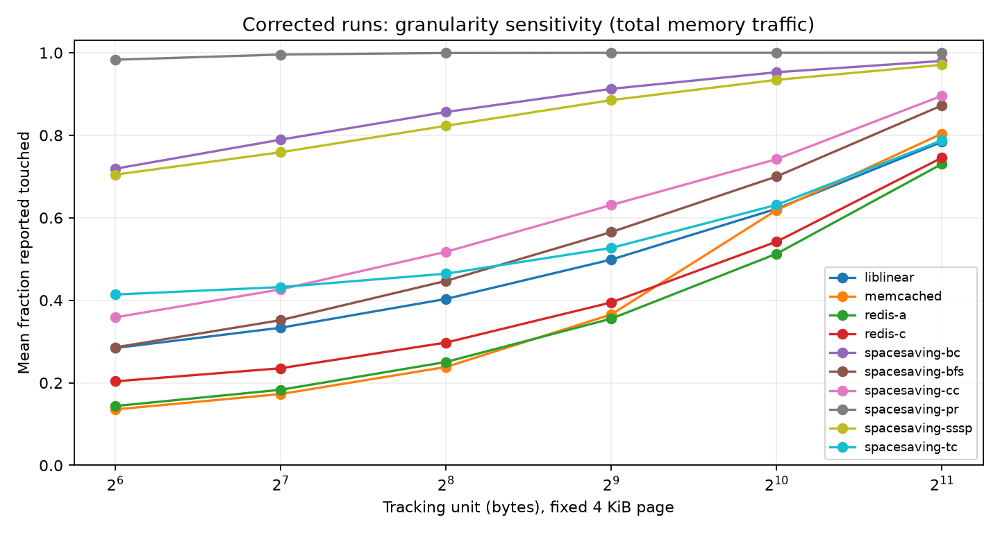
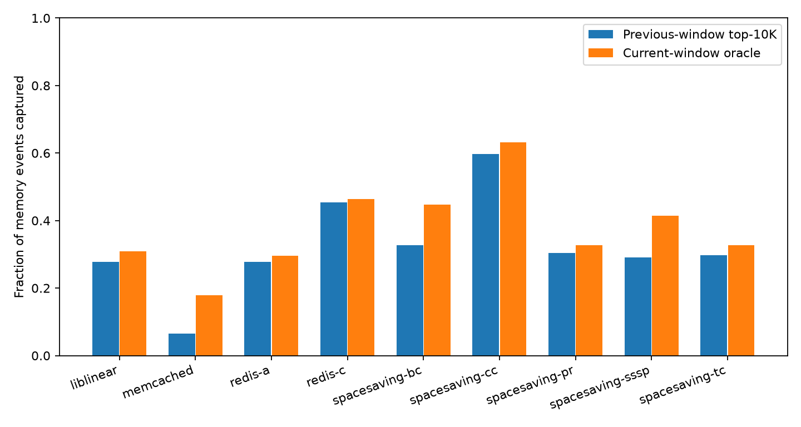
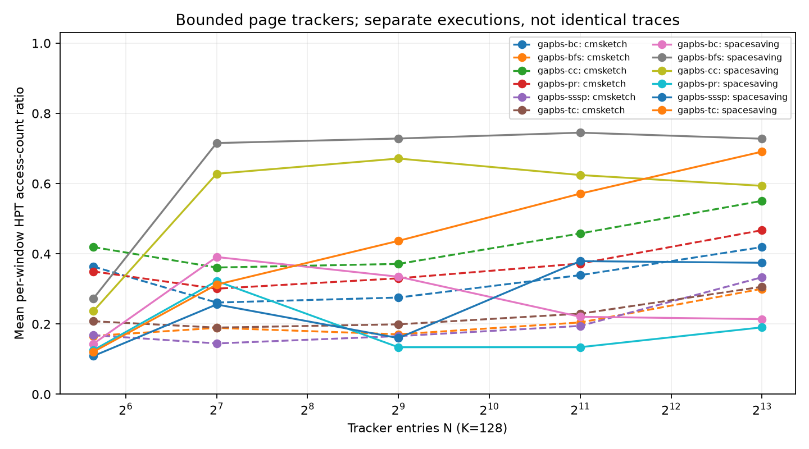
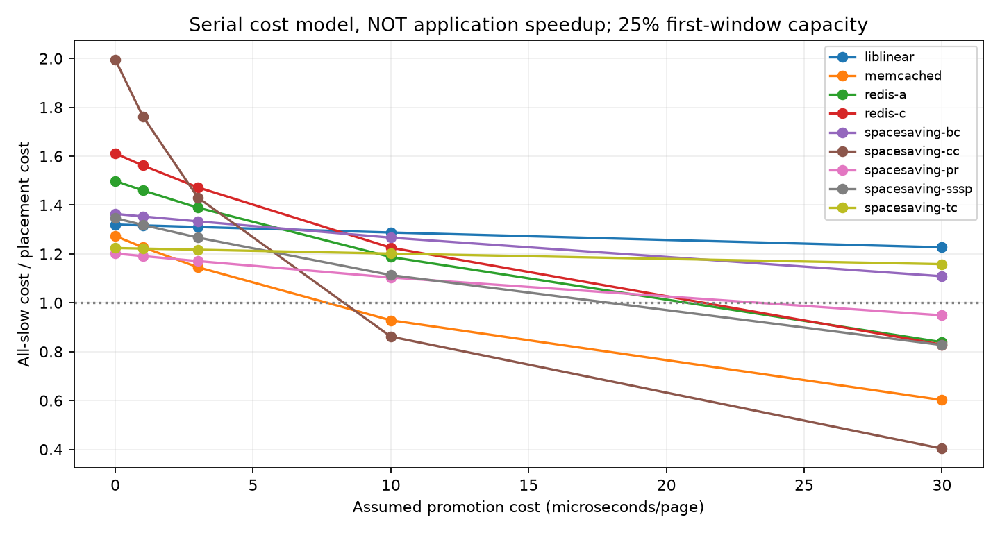

# Extension revalidation: 25 October 2026

This is a fresh campaign using the corrected instrument. A completed benchmark is not automatically a validated analysis. The status tables distinguish the two. Historical measurements are preserved, not relabelled.

## Declared protocol

- Pin: one thread, timed-kernel ROI, cold model, 10M total memory-event windows including the final partial window.
- GAPBS: 40 MiB / 10-way LLC, kron-23 except Google+ snapshot 1 for BC/SSSP. Space-Saving and Count-Min in separate executions, K=128 and budgets 50/128/512/2048/8192.
- Redis A/C and Memcached: custom Zipfian client, 2M records and 10M operations, 4 MiB / 1-way LLC. These are local workload configurations, not exact artifact replication.
- Liblinear: full local KDD2010 kdda, solver 6, tolerance 0.01, one thread. The paper uses KDD2012.
- Simulator: rebuilt SimCXL, high-memory CXL path, 40 MiB / 10-way LLC, Atomic until ROI then TimingSimpleCPU, stop at ROI end. Guest TC uses kron-21, other graph workloads kron-23. This is not a paired identical-trace comparison with Pin.
- Full-system memory-controller and bridge epochs are independent. Do not pool them as synchronized windows, and never add the bridge to its downstream controller (double-counting).
- No workload-specific parameter fitting. ASLR disabled for Pin. No licensed SPEC workload or unmeasured CacheLib result is claimed.

## Calibration

The rebuilt simulator reports 30,321 accepted line requests and 474 page observations at both bridge and controller after draining. Their histograms agree, and sum(words × pages) equals the number of requests. Without draining, seven requests were still in flight. This validates this synthetic path, not arbitrary full-system behaviour.

## Campaign progress

### pin: complete

| Job | State | Elapsed seconds |
|---|---|---:|
| spacesaving-bfs | complete | 4.5 |
| spacesaving-cc | complete | 6.5 |
| spacesaving-bc | complete | 4.5 |
| spacesaving-sssp | complete | 4.5 |
| spacesaving-pr | complete | 1084.7 |
| spacesaving-tc | complete | 13242.4 |
| cmsketch-bfs | complete | 3.4 |
| cmsketch-cc | complete | 2.9 |
| cmsketch-bc | complete | 143.0 |
| cmsketch-sssp | complete | 82.9 |
| cmsketch-pr | complete | 1475.2 |
| cmsketch-tc | complete | 11959.9 |
| redis-a | complete | 3113.1 |
| redis-c | complete | 4297.8 |
| memcached | complete | 2631.7 |
| liblinear | complete | 16752.8 |

### sim: running

| Job | State | Elapsed seconds |
|---|---|---:|
| bfs | complete | 6958.1 |
| cc | complete | 7196.2 |
| bc | complete | 19838.3 |
| sssp | complete | 17886.9 |
| pr | complete | 59625.6 |
| tc | complete | 111843.0 |
| liblinear | running | 0.0 |
| bc-window-1000000 | queued | 0.0 |
| bc-window-100000000 | queued | 0.0 |

## Validated raw-data analyses

| Run | Epochs | Memory events | Word counts saturated |
|---|---:|---:|---|
| liblinear | 1449 | 14,486,247,593 | False |
| memcached | 17 | 162,128,396 | False |
| redis-a | 19 | 182,831,306 | False |
| redis-c | 21 | 205,821,106 | False |
| spacesaving-bc | 4 | 39,243,258 | False |
| spacesaving-bfs | 1 | 9,497,443 | False |
| spacesaving-cc | 2 | 13,383,733 | False |
| spacesaving-pr | 24 | 239,685,775 | False |
| spacesaving-sssp | 2 | 18,291,741 | False |
| spacesaving-tc | 249 | 2,480,411,003 | False |

Raw records must cover every summary observation and event, match the full unique-line histogram, and have unique page keys within consecutive epochs. Saturated word counters invalidate word-frequency rankings, but not touched masks or 64-bit page totals. Single-epoch runs cannot support turnover or previous-window placement.

## Figures

## Interpretation

Granularity is exact re-bucketing of observed virtual addresses. It does not demonstrate OS huge-page allocation or hardware migration waste. Turnover uses deterministic address tie-breaking and traffic-weighted coverage. Stability per memory-event window is not stability per second.

Placement uses previous-window candidates and fixed first-window capacity. The illustrative serial cost uses 100 ns local, 220 ns slow, and promotion costs 0/1/3/10/30 microseconds. It omits demotion costs, CPU execution, MLP, bandwidth contention, and feedback. The cost ratio is neither application speedup nor a proven bound. Revalidation cannot turn this model into a measured speedup.

## Code and outputs

`experiments/revalidation_campaign.py` runs the two lanes. Per-job manifests retain commands and hashes. `src/analysis/revalidate_extensions.py` processes complete raw records one epoch at a time; compressed files avoid multi-gigabyte intermediates. `results/revalidated-2026-10-25/analysis/` holds machine-readable granularity, turnover, placement and cost sensitivity results.

Shutdown stops running work. Re-running a lane preserves completed jobs; a partially completed benchmark must restart. Pin has no mid-run checkpoint. The simulator lane can use the separately validated process-snapshot supervisor; see [checkpointing](checkpointing.md). Old interrupted jobs without snapshots restart.

## Simulator Figure 4 comparison

The [validated simulator comparison](simulator-figure4.md) reports each port separately and excludes interrupted runs. Its three-row figure contrasts digitized M5, the Pin baseline and accepted CXL bridge requests; the streams and inputs are not identical.
