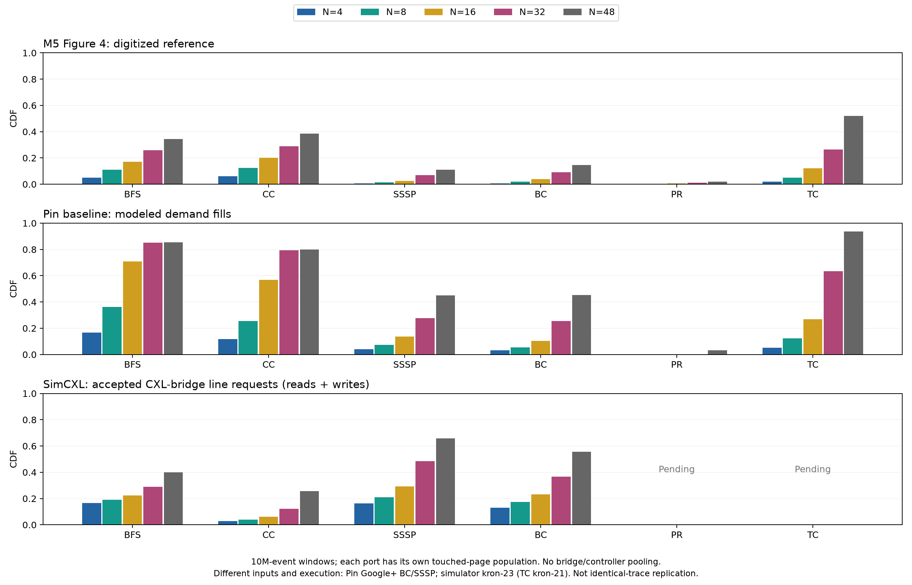
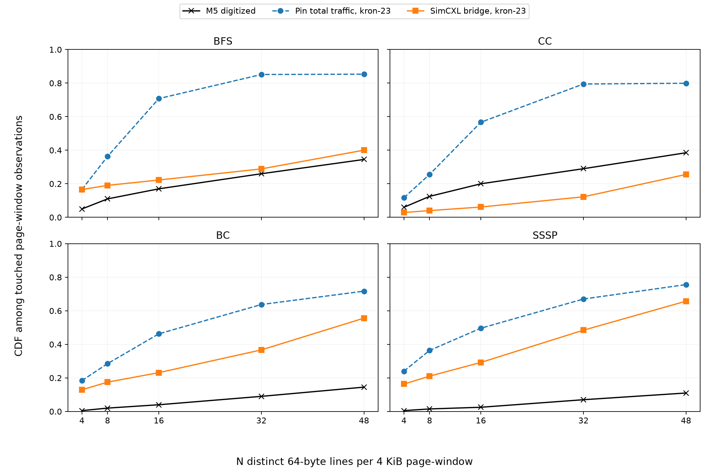

# M5 Figure 4-style simulator comparison

Only jobs marked complete with ROI-end evidence and intact full histograms enter this report. Interrupted jobs are pending, not zero-valued measurements.

| Job | Port | Maximum five-point difference (pp) | Events | Page-window observations |
|---|---|---:|---:|---:|
| bfs | high-controller | 11.58 | 25,752,145 | 312,334 |
| bfs | ordinary-controller | 48.19 | 19,067 | 283 |
| bfs | bridge | 11.58 | 25,752,145 | 312,334 |
| cc | ordinary-controller | 47.69 | 14,367 | 268 |
| cc | high-controller | 16.76 | 30,388,450 | 418,607 |
| cc | bridge | 16.76 | 30,388,450 | 418,607 |
| bc | high-controller | 41.11 | 358,497,811 | 3,943,090 |
| bc | bridge | 41.11 | 358,497,811 | 3,943,090 |
| bc | ordinary-controller | 40.35 | 296,366 | 711 |
| sssp | bridge | 54.73 | 257,564,245 | 2,843,919 |
| sssp | high-controller | 54.73 | 257,564,245 | 2,843,919 |
| sssp | ordinary-controller | 38.51 | 714,170 | 412 |

## Same input-family, writeback-inclusive control

The primary overview retains the current Pin baseline, which uses Google+ for BC/SSSP. The supplementary control instead uses existing kron-23 Pin total-traffic results for all four completed graph workloads. This removes that graph-family mismatch and includes writebacks on both sides; it still does not establish identical graph files, binaries or traces.

| Workload | Pin kron-23 traffic error (pp) | Simulator bridge error (pp) |
|---|---:|---:|
| bfs | 59.14 | 11.58 |
| cc | 50.47 | 16.76 |
| bc | 57.20 | 41.11 |
| sssp | 64.61 | 54.73 |

## Interpretation

The bridge is the primary device-side comparison; ordinary and high-memory controllers are reported separately as diagnostics. Bridge and downstream controller observe overlapping traffic and must not be added. Independent port clocks must not be pooled as synchronized windows.

Simulator requests include physical and kernel traffic, unlike Pin user-space operands. They also reflect a different CPU, cache, OS and placement configuration. Pin demand fills exclude dirty writebacks; the bridge reads+writes stream does not. This is not an isolated kernel-visibility experiment or a paired same-input comparison.

The simulator uses an atomic warm-up then TimingSimpleCPU within the timed ROI. Graphs are kron-23 except TC kron-21; M5 uses unavailable reduced real-world inputs. The exact original collection clock and page population remain unresolved. Reference values are digitized, approximately +/-2 pp.

The pooled summary cannot reconstruct a whole-ROI union; no such simulator result is claimed. Raw comparison values and per-output hashes are preserved beside the figure.
