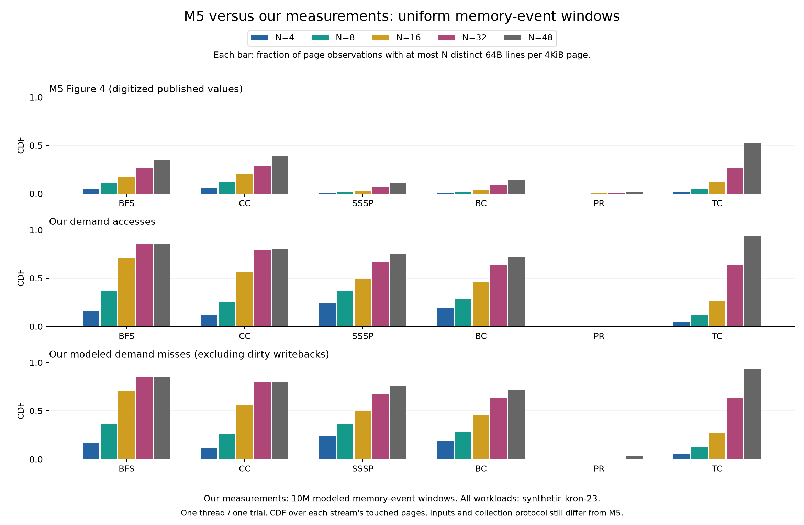
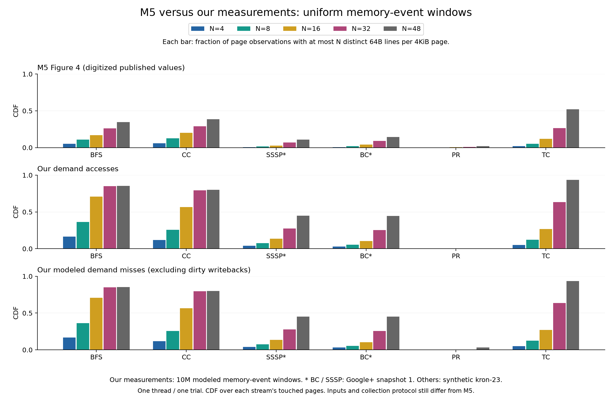

# Uniform-window campaign (2026-10-18)

Saved results, figures and automated checks revalidated on 2026-10-23.

## Declared protocol

The previous six-workload overview mixed 10M raw-reference windows (BFS, CC,
PR, TC) with 10M memory-event windows (Google+ BC/SSSP). It is not the primary
reproduction figure for this campaign.

All six now use **10 million modeled memory events per window**, where an event
is a demand LLC fill or a dirty LLC writeback. Access, fill and traffic masks
are reset together after the same execution interval. The final partial window
is retained. This is a predeclared local protocol, not an established M5 protocol.

Constants: stock GAPBS, one thread, one trial, timed-kernel ROI, cold cache model,
40 MiB / 10-way LLC. No fitted window or best-result selection is performed.

Two complete views are reported:

- All six on synthetic kron-23, holding the input family constant in the
  raw-reference versus memory-event window comparison.
- Google+ snapshot 1 for BC/SSSP and kron-23 for the other four, with identical
  window semantics. The two input families are labeled explicitly.

The second view more closely follows the artifact's BC/SSSP dataset family,
but neither view matches M5's exact graph reductions or 20-thread execution.
Demand misses and total traffic are scored separately against the digitized
five-threshold reference; they must not be silently interchanged.

## Commands

```bash
./.venv/bin/python experiments/run_paired.py bfs cc pr tc --epoch-traffic 10 --out results/matched-family/kron-traffic10
./.venv/bin/python src/analysis/plot_latest_fig4.py --all-synthetic
./.venv/bin/python src/analysis/plot_latest_fig4.py
```

The already completed BC/SSSP memory-event runs are reused without modification.
The four new runs must complete before either full figure is generated. Plotting
checks completion, cache/window settings, a common profiler binary, event totals,
histogram consistency, common-page populations and cold-cache whole-ROI unions.

## Artifact recovery

See the [search record and author-request draft](m5-author-request.md). The
public repository still does not provide the missing dataset download location
or a located Figure 4 collection script. The request is a draft only; nothing
has been sent or posted on the user's behalf.

## Results

All four additional runs completed without an epoch cap: BFS (12.8 s), CC
(19.8 s), PR (732.1 s), TC (8401.5 s). BC/SSSP reuse the completed follow-up
runs. These are instrumented wall times, not application performance results.

### Same-input window comparison

Maximum absolute CDF error over N = 4, 8, 16, 32, 48, using **total modeled
traffic** (fills plus dirty writebacks). Lower is closer; 0.10 means ten
percentage points, not ten percent relative error.

| Workload, synthetic kron-23 | 10M raw-reference windows | 10M memory-event windows | Outcome |
|---|---:|---:|---|
| BFS | 0.518 | 0.591 | Worse |
| CC | 0.489 | 0.505 | Worse |
| SSSP | 0.872 | 0.646 | Closer, still far |
| BC | 0.829 | 0.572 | Closer, still far |
| PR | 0.616 | 0.011 | Close at all five reference points |
| TC | 0.530 | 0.416 | Modest improvement, still far |

The earlier synthetic manifests have matching input paths and byte counts but
**no execution-time input SHA256**; we do not invent those hashes retrospectively.
Benchmark binary hashes match. Profiler hashes differ: the newer build adds the
gather/scatter rejection guard described in the audit. These are separate
executions, not a replay of an identical trace; small event-count differences
remain. Thus the table is a controlled window comparison with stated provenance
limits, not perfect bit-for-bit isolation. All six current memory-window runs
share the same profiler hash and include input hashes in their manifests.



### Current input-family follow-up

Keep the same window definition but use Google+ snapshot 1 for BC/SSSP. Their
traffic errors become **0.303** and **0.339**, respectively, versus 0.572 and
0.646 on kron-23. Dataset size and topology both change. This is not a pure
topology experiment and the snapshot is not M5's exact reduced graph.

| Workload | Access error | Demand-fill error | Traffic error | Memory-event windows |
|---|---:|---:|---:|---:|
| BFS | 0.591 | 0.591 | 0.591 | 1 |
| CC | 0.505 | 0.505 | 0.505 | 2 |
| SSSP (Google+) | 0.337 | 0.340 | 0.339 | 2 |
| BC (Google+) | 0.300 | 0.307 | 0.303 | 4 |
| PR | 0.020 | 0.011 | 0.011 | 24 |
| TC | 0.416 | 0.416 | 0.416 | 249 |



The figure's bottom row is **demand fills**, not total traffic. Both metrics
are retained in the table and machine-readable scores. The M5 row is digitized
from the published figure, not newly measured hardware data.

### What this establishes

- Window semantics explain much of the PageRank disagreement. Numerical closeness
  under our local protocol still does not establish M5's protocol or input fidelity.
- A longer window is not a universal fix: BFS and CC are negative results.
  Their input graph and single-thread execution still differ from the paper's setup.
- BFS generates only 9,504,565 memory events, so its only window is the full ROI.
  Cold-cache first touches make its access/fill/traffic coverage masks identical.
  Nevertheless it has 168,833,287 raw accesses and only 7,923,722 demand fills:
  **equal coverage does not mean equal event counts or no cache benefit**.
- In the other workloads, longer windows allow repeated accesses and occasional
  misses to cover similar sets of lines. This reduces access/miss coverage gaps
  without eliminating cache filtering. TC has about 117.14B accesses versus
  2.45B fills, despite its almost identical access/miss coverage curves.
- We have not reproduced all six curves. Five still have substantial errors.
  Neither these data nor the earlier cache controls establish a hardware ceiling.

### Outputs and checks

`results/uniform-kron-traffic10/` and `results/uniform-traffic10/` each contain:
`scores.csv` (all three streams, pooled and whole-ROI), `comparison.csv` (all five
thresholds), `window-controls.csv` (baseline comparison and provenance caveats),
and `sources.json` (complete run manifests).

Every run passed event-total checks, paired-population checks, histogram/summary
agreement and the cold-cache whole-ROI union invariant. `make audit-test` also
tests rejection of incomplete, mixed-window, mixed-binary and wrong-cache
campaigns. The figures retain final partial windows and use page-observation
weighting; no workload-specific window was fitted to the reference.

The next fidelity improvement is to recover the authors' reduced Twitter/Google+
inputs and Figure 4 counter schedule. The [draft clarification request](m5-author-request.md)
asks for those details, including the page denominator and 9-versus-10-way CAT
discrepancy. It has not been sent. Running arbitrary reductions or selecting a
different window for each workload would not resolve that evidence gap.
